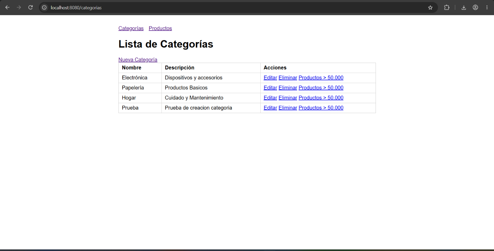
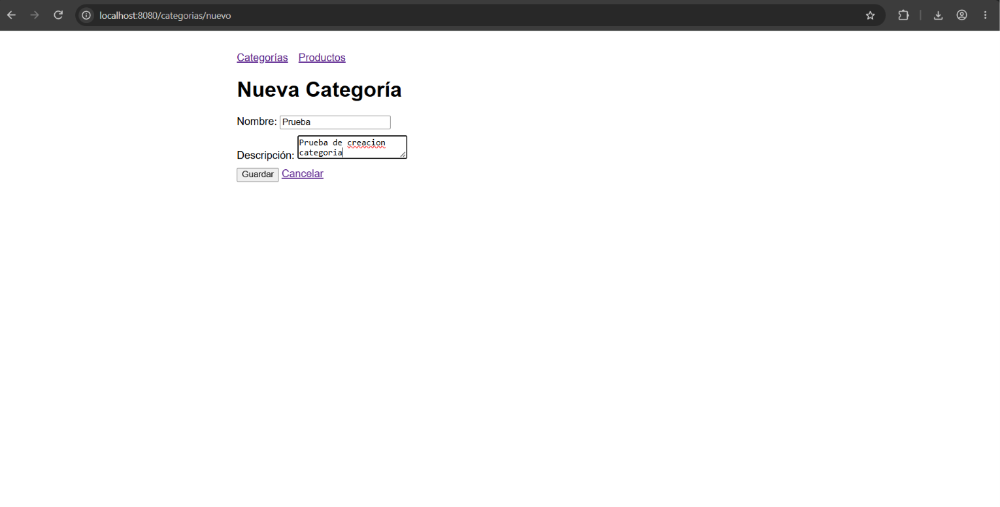
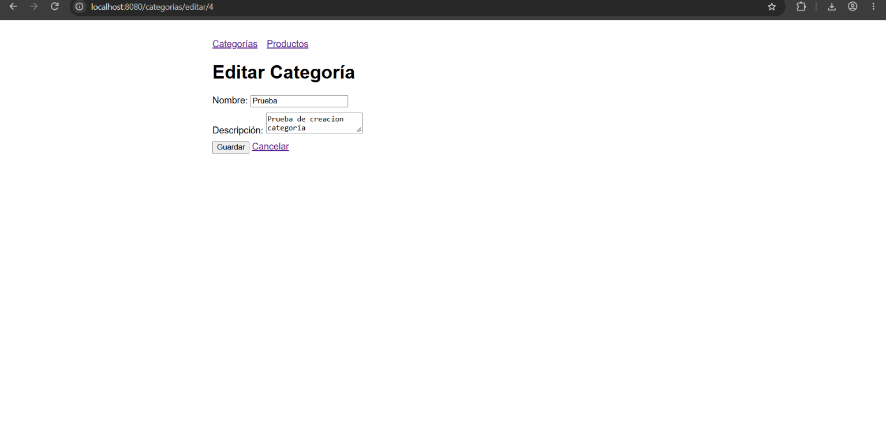
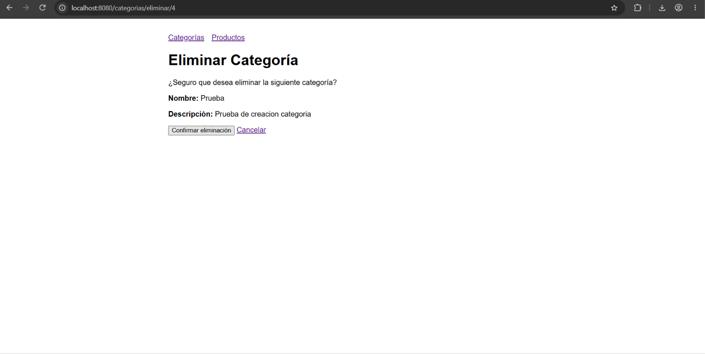
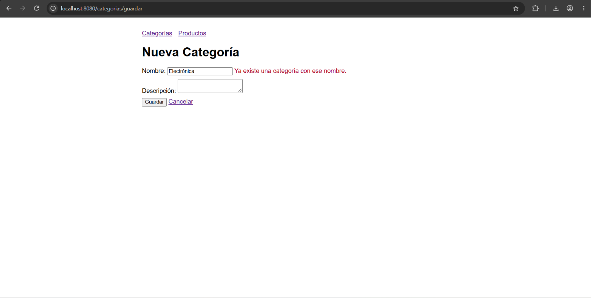
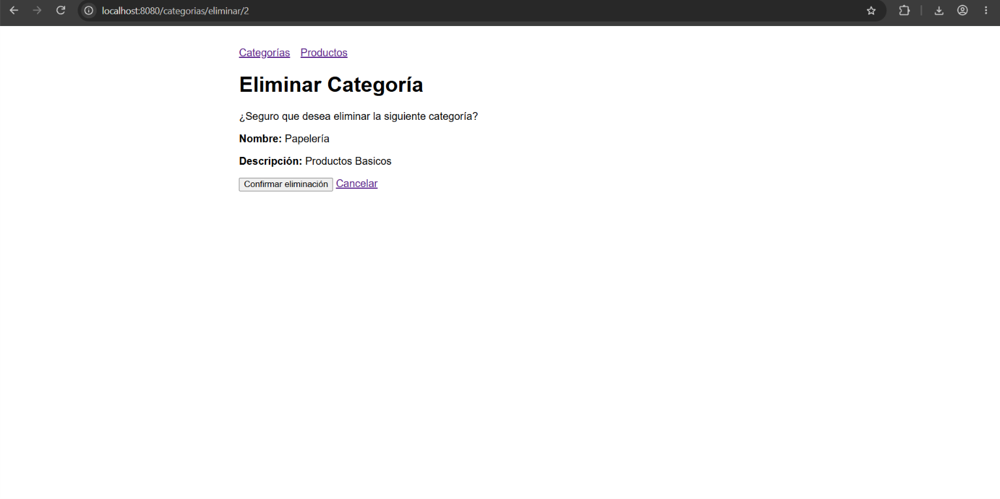
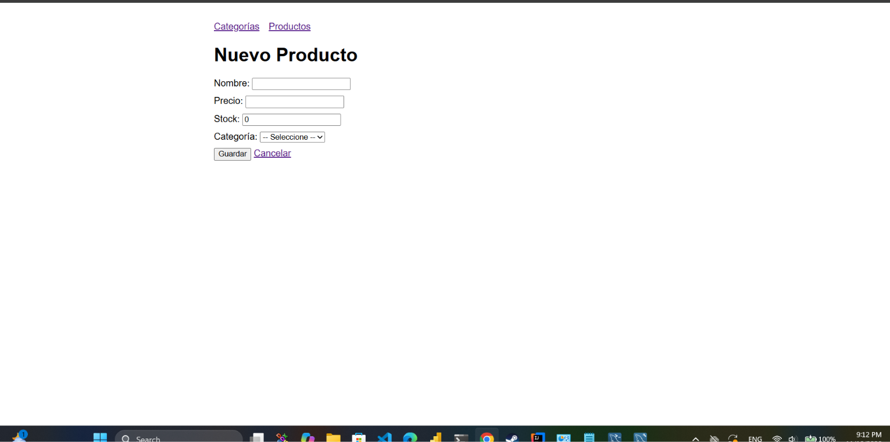
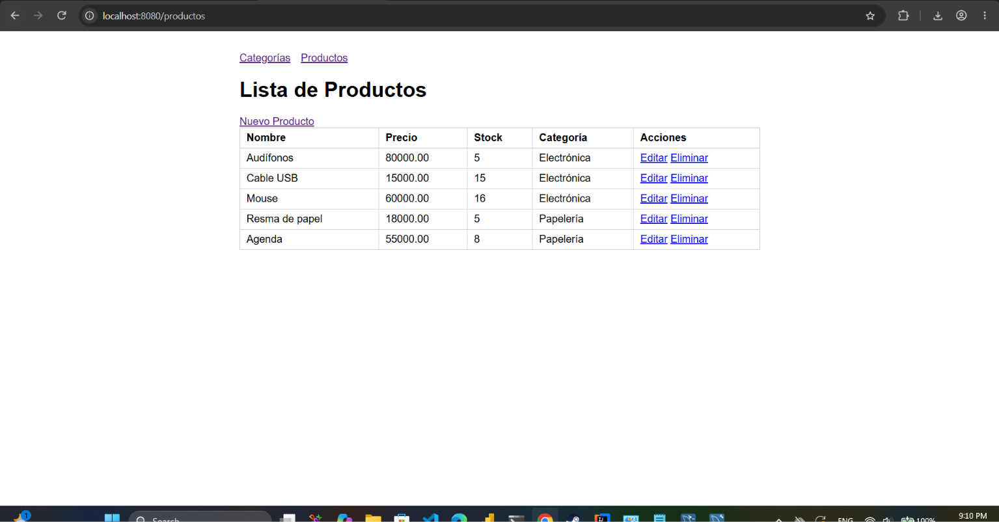
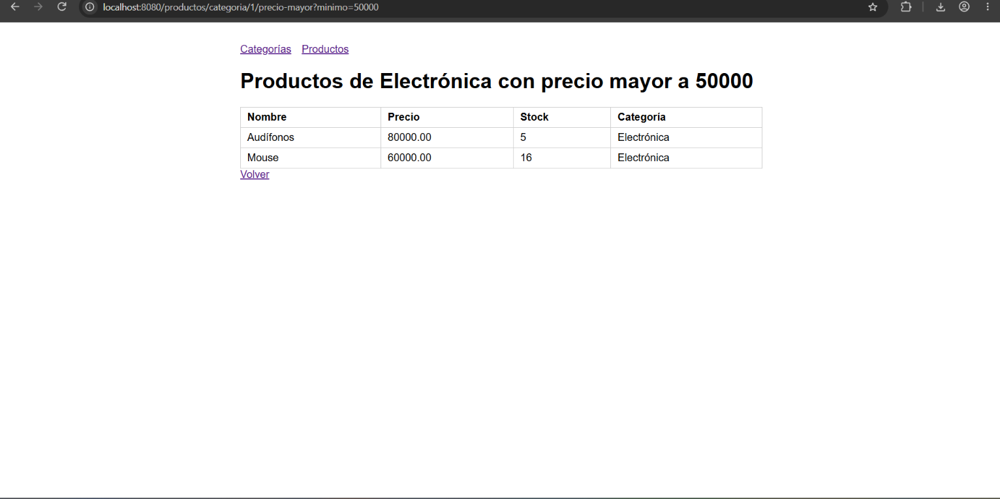
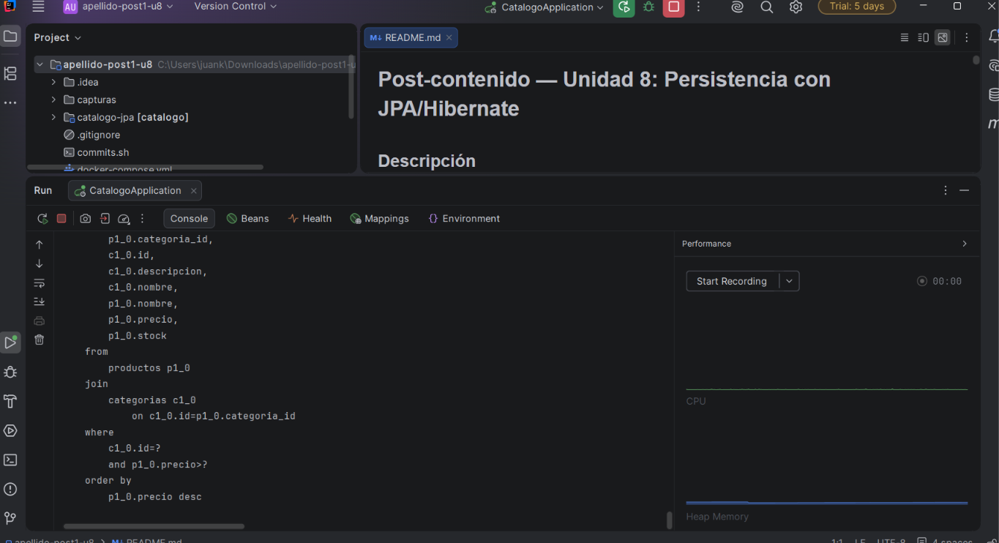

# Post-contenido — Unidad 8: Persistencia con JPA/Hibernate

## Descripción
Repositorio del laboratorio de la Unidad 8 de Programación Web — Séptimo Semestre.
Contiene un único proyecto Maven Spring Boot (`catalogo-jpa/`) con un CRUD de categorías
usando Spring Data JPA e Hibernate contra MySQL, y su extensión con la entidad `Producto`
y una relación `@ManyToOne/@OneToMany` hacia `Categoria`.

## Funcionalidades implementadas
- CRUD completo de Categoría (listar, crear, editar, eliminar con confirmación).
- Validación con Bean Validation (`@NotBlank`, `@Size`, `@Positive`, `@Min`) y nombre de categoría único (mensaje legible en el formulario).
- CRUD de Producto asociado a una categoría (select de categorías).
- Consulta JPQL personalizada: productos de una categoría con precio mayor a un valor (`JOIN FETCH`, una sola sentencia SQL).
- Rechazo de borrado de categorías con productos asociados.

## Parte 1 — CRUD de Categoría con JPA/Hibernate y MySQL
`CategoriaController`, `CategoriaService` y `CategoriaRepository` (`JpaRepository`) gestionan la entidad
`Categoria`, persistida en MySQL mediante Hibernate, con plantillas Thymeleaf
(`lista.html`, `formulario.html`, `confirmar-eliminar.html`).

## Parte 2 — Relación @ManyToOne/@OneToMany con Producto
`Producto` es el lado propietario (`categoria_id`, `FetchType.LAZY` explícito) y `Categoria` el lado inverso
(`mappedBy`). `ProductoRepository.buscarPorCategoriaConPrecioMayorA` es la consulta JPQL con `@Query` y `JOIN FETCH`.

### Diagrama de la relación
```
+------------------+ 1                 N +----------------------+
|    categorias    |---------------------|      productos       |
+------------------+                     +----------------------+
| id (PK)          |<--------------------| id (PK)              |
| nombre (UNIQUE)  |   categoria_id (FK) | nombre               |
| descripcion      |                     | precio DECIMAL(10,2) |
+------------------+                     | stock                |
 @OneToMany(mappedBy)                    | categoria_id NOT NULL|
                                         +----------------------+
                                          @ManyToOne(LAZY) + @JoinColumn
```

## Configuración de la base de datos
Opción A — Docker: `docker compose up -d` (crea `catalogo_db` y el usuario `appuser`/`apppass`).

Opción B — MySQL local:
```sql
CREATE DATABASE catalogo_db CHARACTER SET utf8mb4 COLLATE utf8mb4_unicode_ci;
CREATE USER "appuser"@"localhost" IDENTIFIED BY "apppass";
GRANT ALL PRIVILEGES ON catalogo_db.* TO "appuser"@"localhost";
FLUSH PRIVILEGES;
```
Luego revisar `catalogo-jpa/src/main/resources/application.properties` (URL, usuario y contraseña).

## Cómo compilar y ejecutar
1. `git clone [URL-del-repo]`
2. Crear la base de datos (ver arriba).
3. `cd catalogo-jpa && ./mvnw spring-boot:run`
4. Parte 1: http://localhost:8080/categorias — Parte 2: http://localhost:8080/productos
5. Consulta filtrada: http://localhost:8080/productos/categoria/{id}/precio-mayor?minimo=50000

## Decisiones de diseño
- **`ddl-auto=update` en lugar de `create`**: conserva los datos de prueba entre reinicios mientras se agregaban las entidades.
- **Nombre único en Categoria**: `unique = true` en la columna y verificación temprana en `CategoriaService`, con error en el formulario.
- **`FetchType.LAZY` explícito en `Producto.categoria`**: `@ManyToOne` es EAGER por defecto; LAZY evita cargar la categoría en cada acceso. Las vistas que necesitan el nombre usan `JOIN FETCH` en el repositorio (evita `LazyInitializationException` y N+1).
- **Sin `cascade = REMOVE` de Categoria a Producto**: eliminar una categoría con productos se rechaza en el servicio para evitar pérdida accidental de datos.
- **Métodos helper** `agregarProducto/quitarProducto` en `Categoria` para mantener sincronizados ambos lados de la relación.

## Capturas de pantalla
### Categorías






### Productos




